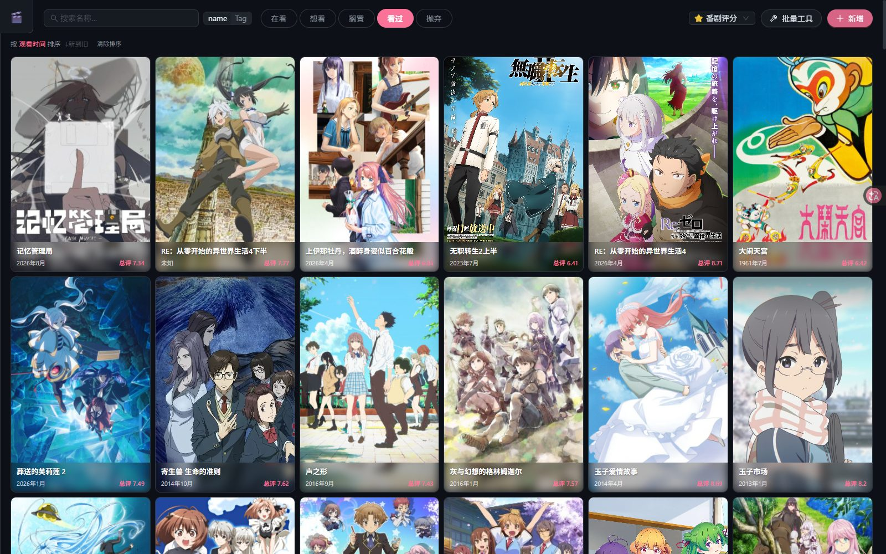
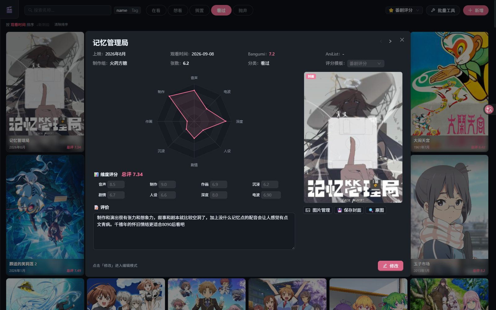
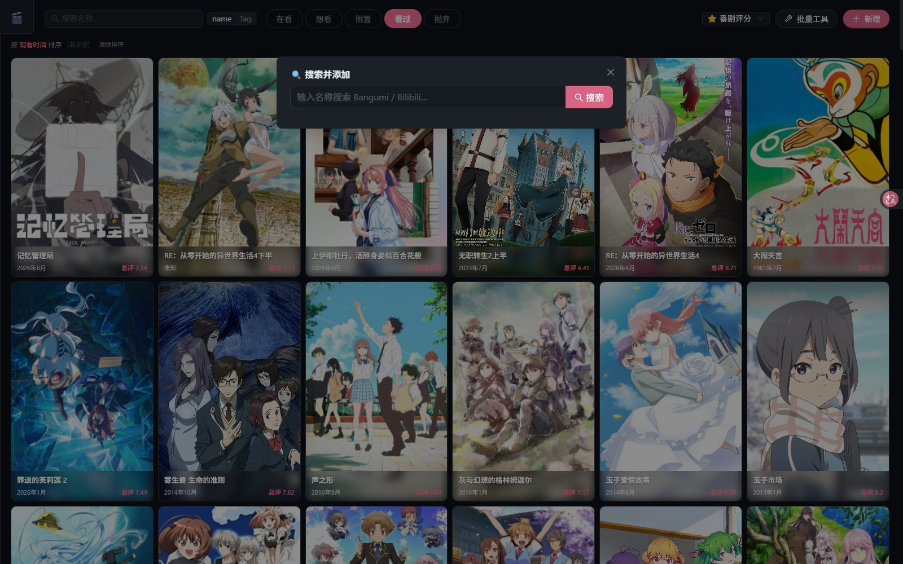
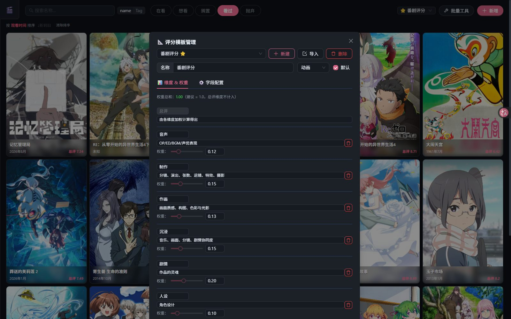
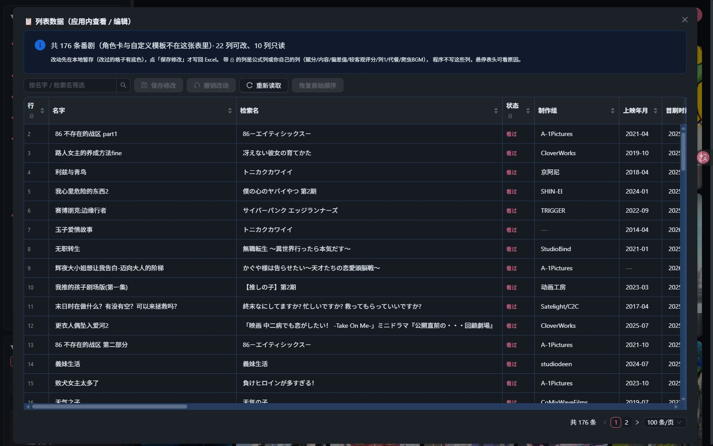

# AnimeDiary — 番剧评分管理系统

> "记录你与每部番的相遇"

一款**本地优先**的个人番剧管理工具：把看过的每一部番记下来，按自己的维度打分、写评价、追进度，
再回头看看自己的口味长什么样。**数据是你自己的一个 Excel 文件**，程序只是它的一个更好用的界面。

> 稍微改改维度模板，也可以用来管理其他影视、书、画、游戏、论文。

**主界面** — 海报网格，卡片底部显示当前选中维度的分数



**详情面板** — 雷达图、逐维度评分、评价、海报轮播



---

## 目录

- [它解决什么问题](#它解决什么问题)
- [功能](#功能)
- [界面预览](#界面预览)
- [技术栈](#技术栈)
- [架构](#架构)
- [快速开始](#快速开始)
- [数据与备份](#数据与备份)
- [前端热更新](#前端热更新)
- [AI 功能配置](#ai-功能配置)
- [License](#license)

---

## 它解决什么问题

市面上的追番工具都要求你把数据交给它。AnimeDiary 反过来：

- **数据是本地的一个 `.xlsx`** —— 你可以直接用 Excel 打开、筛选、画图、发给别人；
  程序里改的会写回文件，在 Excel 里改的程序也能读到
- **评分维度你自己定** —— 不只有"打几分"，而是 8 个维度（音声 / 制作 / 作画 / 沉浸 / 剧情 / 人设 / 深度 / 电波）
  加权算总评，每个维度还能单独写一段评价
- **不联网也能用** —— 联网只用于搜番、拉海报、AI 分析；评分数据永远在本地

---

## 功能

### 番剧入库

- 搜索添加，支持 **Bangumi / AniList** 双源，自动补全海报与上映信息
- 分类（在看 / 想看 / 搁置 / 看过 / 抛弃）+ 自由标签
- 数据补全面板：批量扫描缺字段的条目，逐个确认后写回



### 多维度评分

- 维度、权重、描述都在「模板管理」里改；**改完总评会跟着变**
- 除了番剧评分，还内置一套**角色评分**模板（角色设计 / 性格 / 声优 / 萌点电波 / 好感度）——
  角色卡是独立条目，可以从番剧详情里一键建卡
- 同一个模板下的所有条目共用一套权重（不是每条单独调）



### 表格视图（应用内直接改列表）

不用打开 Excel 就能看和改列表本身：

- **32 列**，其中 22 列可编辑
- 公式列（赋分 / 内容 / 偏差值 / 较客观评分 / 总评）和用户自有列（列1 / 代餐）**只读**，
  表头有 🔒 说明原因 —— 避免了"改了被公式覆盖"这种白改
- **排序**：表头点一下升序、两下降序、三下取消，**跨全表**（不是只排当前页）
- 改动先暂存（改过的格子有底色），点「保存修改」才写回



### 数据进出

- **导出 Excel**：按记录类型分成 5 张表 —— `番剧` / `角色卡` / `模板_<模板名>` / `异常行`，
  每张表只放自己有效的列，分和自定义字段都拆成真列（不是一堆 JSON）
- **导入 Excel**：导出格式和旧格式都认，导入时重建内部结构再落盘
- **一键备份 / 恢复**：导出 ZIP（含数据 + 图片），导入即可完整恢复

### 其他

- **排名系统** — 百分位排名，可按任意维度排序筛选
- **雷达图** — 单番能力图 / 偏好画像对比，两种模式（百分位 / 固定值）
- **知识图谱** — 力导向图展示番剧 · 制作公司 · 标签 · 角色之间的关系
- **追番日历** — 按首刷时间排列的时间轴
- **AI 分析套件** — 品味报告 / 偏好画像 / 智能推荐 / 单番分析 / 图谱优化 / 自动打 Tag
- **海报与截图** — AniList 搜索海报、本地图片管理、在线截图与录制、一键去白底
- **主题** — 深色 / 浅色、自定义配色

---

## 界面预览

| 侧栏（时间轴 + 维度排序 + 排行榜） | 表格视图 |
|---|---|
|  |  |

---

## 技术栈

| 层面 | 技术 |
|---|---|
| 前端框架 | React 18 + TypeScript |
| UI 组件库 | Ant Design 5 |
| 图表 | ECharts 5 |
| 构建工具 | Vite 6 |
| 桌面壳 | Electron 33 |
| 数据存储 | Excel (.xlsx) + localStorage + IndexedDB |
| 外部 API | Bangumi、AniList、LLM（DeepSeek / OpenAI 兼容协议） |
| 测试 | Vitest（384 用例） |

---

## 架构

按**单点职责**分层：

```
AnimeDiary/
├── core/                 纯工具函数（数学 / 颜色 / 文本 / 日期 / 角色解析）
├── features/             业务模块，每块独立
│   ├── ai-analysis/      AI 分析套件（6 个 Skill）
│   ├── anime-data/       数据持久层：Excel 读写 / 模板 / 导出导入 / D 列重建
│   ├── anime-detail/     ScoreSlider 评分滑块
│   ├── character-complete/  角色补全 + 角色卡合并
│   ├── image-management/ 海报 / 截图 / 去白底
│   ├── knowledge-graph/  力导向图
│   ├── media-complete/   数据补全面板
│   ├── ranking/          百分位排名
│   ├── search-add/       Bangumi / AniList 搜索入库
│   └── watch-calendar/   追番时间轴
├── context/              React Context + useReducer 全局状态
├── electron/             主进程 + 预加载 + 本地服务 + 热更新 + 数据初始化
├── server/               /api 路由（开发与打包后共用同一份实现）
├── src/                  应用层（组件 + 主题 + 类型）
└── tests/                Vitest 单元 / 集成测试
```

**数据流**：

```
Excel(.xlsx) ←→ /api 中间件 ←→ excel-service ←→ Context(reducer) ←→ UI
localStorage / IndexedDB ←→ storage-service ←→ Context(reducer) ←→ UI
外部 API(Bangumi / AniList / LLM) ←→ 各 service ←→ UI
```

**为什么开发能跑、装上也一定能跑**：开发时 `/api/*` 由 Vite 插件提供，打包后由 Electron 主进程起一个
只监听 `127.0.0.1` 的本地服务提供 —— 两者复用**同一份** `server/api-routes.ts`，
不存在两套实现。

---

## 快速开始

### 环境要求

- Node.js >= 18
- npm >= 9

### 安装与启动

```bash
git clone https://github.com/Re02VClife/AnimeDiary.git
cd AnimeDiary
npm install

npm run dev:web     # 纯 Web 模式，浏览器打开 http://localhost:5173
npm run dev         # Electron 桌面模式
```

> ⚠️ **dev 模式的数据目录是项目根目录**（`vite.config.ts` 里 `DATA_DIR: __dirname`），
> 打包版才用「文档/AnimeDiary」。所以开发时改动数据不会碰到你安装版的真实文件。

### 构建桌面应用

```bash
npm run build       # 生成 release/AnimeDiary-Setup-<版本>.exe
npm run build:dir   # 只生成免安装目录 release/win-unpacked，便于本地验证
```

流程：`build:api`（把 `server/api-routes.ts` 编译成 Electron 可 require 的 cjs）→ `vite build` → `electron-builder`。

> 构建卡在下载 electron-builder 二进制（GitHub 连不上）时，先设镜像：
>
> ```powershell
> $env:ELECTRON_BUILDER_BINARIES_MIRROR = 'https://npmmirror.com/mirrors/electron-builder-binaries/'
> ```

### 运行测试

```bash
npm test            # 单次运行
npm run test:watch  # 监听模式
npx tsc --noEmit    # 类型检查（本项目没有 linter，这是唯一静态检查）
```

---

## 数据与备份

安装版的数据都在「文档/AnimeDiary/」：

```
文档/AnimeDiary/
├── 番评分.xlsx     主数据（可直接用 Excel 打开编辑）
├── images/         海报与截图
└── backups/        多代快照（每次写 Excel 前自动留存）
```

- 首次启动自动创建带表头的空白 `番评分.xlsx`
- 已有数据可用面板上的「导入 Excel」导入
- **写 Excel 有三道保护**：写入前比对目标行的名字（不符就整批拒绝，绝不写错行）、
  只有白名单列可写（公式列碰不到）、原子写 + 快照

### 从浏览器版迁移本地设置

浏览器访问时，分类、自定义模板、海报焦点、AI 配置都存在浏览器 localStorage 里，与桌面版是**两套独立存储**：

1. `npm run dev:web` 启动开发服务器
2. 用**你平时访问该应用的那个浏览器**打开 <http://localhost:5173/api/_migrate-export>
3. 页面自动把本地数据交给服务端，在项目根目录生成 `browser-migration.json`
4. 把它复制到桌面版数据目录，重启桌面版 —— 会自动写入并改名成 `.applied`

> 该文件含 AI API Key 等敏感内容，已被 `.gitignore` 忽略。

---

## 前端热更新

只改 React 代码 / 样式时**不用重新安装**：

```bash
node .review/bump-version.js 1.0.49   # 或手动改 package.json 的 version（必须变！）
npx vite build                        # 先构建前端
npm run update:pack                   # 再打包，产出 release/web-update/{zip, latest.json}
```

把 `release/web-update/` 里的两个文件放进「更新源」目录，客户端启动后自动检查并下载，**重启后生效**。

> ⚠️ `npm run update:pack` **只做 `build:api` + 打包，不做前端构建** ——
> 顺序反了会把旧 dist 打进 zip，现象是"更新下载成功但版本没变"。

更新源可以是**一个本地文件夹**（最省事，不需要任何服务器），也可以是 HTTP 静态目录。
配置在 `%APPDATA%/anime-diary/update-config.json`（注意目录名是 `anime-diary`）：

```json
{ "updateUrl": "E:\\AnimeDiary-updates", "autoCheck": true }
```

本地验证热更新：`npm run update:serve`（起 `http://127.0.0.1:8787/updates/`），
然后在侧栏「桌面应用」里点「检查更新」。

---

## AI 功能配置

AI 分析需要配置 LLM 接口，支持 DeepSeek / OpenAI 兼容协议：

1. 打开程序后点左下角 **AI 设置**
2. 填入 API Key、Base URL 和模型名
3. 选择要用的 Skill

---


---

## License

MIT
