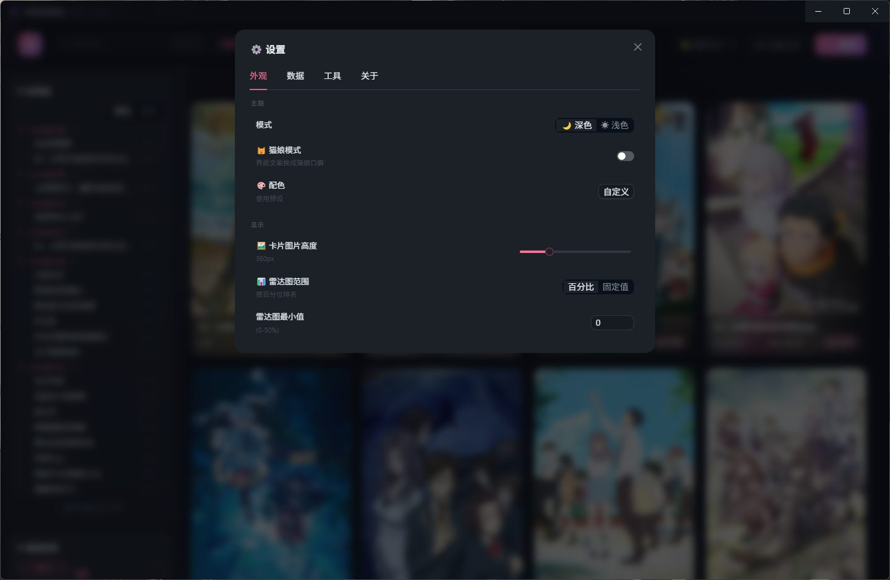

# AnimeDiary — 番剧评分管理系统

> "记录你与每部番的相遇"

一款**本地优先**的个人番剧管理工具：把看过的每一部番记下来，按自己的维度打分、写评价、追进度，
再回头看看自己的口味长什么样。**数据是你自己的一个 Excel 文件**，程序只是它的一个更好用的界面。

> 稍微改改维度模板，也可以用来管理其他影视、书、画、游戏、论文。

**主界面** — 海报网格，卡片底部显示当前选中维度的分数


**详情面板** — 雷达图、逐维度评分、评价、海报轮播


**设置** — 外观 / 数据 / 工具 / 关于 四页，主题、配色、雷达范围、导入导出、备份回退都在这里



---

## 目录

- [它解决什么问题](#它解决什么问题)
- [功能](#功能)
- [界面预览](#界面预览)
- [技术栈](#技术栈)
- [架构](#架构)
- [快速开始](#快速开始)
- [数据与备份](#数据与备份)
- [前端热更新](#前端热更新)
- [AI 功能配置](#ai-功能配置)
- [可选扩展](#可选扩展)
- [当前不足](#当前不足)
- [License](#license)

---

## 它解决什么问题

市面上的追番工具都要求你把数据交给它。AnimeDiary 反过来：

- **数据是本地的一个 `.xlsx`** —— 你可以直接用 Excel 打开、筛选、画图、发给别人；
  程序里改的会写回文件，在 Excel 里改的程序也能读到
- **评分维度你自己定** —— 不只有"打几分"，而是 8 个维度（音声 / 制作 / 作画 / 沉浸 / 剧情 / 人设 / 深度 / 电波）
  加权算总评，每个维度还能单独写一段评价
- **不联网也能用** —— 联网只用于搜番、拉海报、AI 分析；评分数据永远在本地

---

## 功能

### 番剧入库

- 搜索添加，支持 **Bangumi / AniList** 双源，自动补全海报与上映信息
- 分类（在看 / 想看 / 搁置 / 看过 / 抛弃）+ 自由标签
- 数据补全面板：批量扫描缺字段的条目，逐个确认后写回

### 多维度评分

- 维度、权重、描述都在「模板管理」里改；**改完总评会跟着变**
- 除了番剧评分，还内置一套**角色评分**模板（角色设计 / 性格 / 声优 / 萌点电波 / 好感度）——
  角色卡是独立条目，可以从番剧详情里一键建卡
- 同一个模板下的所有条目共用一套权重（不是每条单独调）


### 表格视图（应用内直接改列表）

不用打开 Excel 就能看和改列表本身：

- **32 列**，其中 22 列可编辑
- 公式列（赋分 / 内容 / 偏差值 / 较客观评分 / 总评）和用户自有列（列1 / 代餐）**只读**，
  表头有 🔒 说明原因 —— 避免了"改了被公式覆盖"这种白改
- **排序**：表头点一下升序、两下降序、三下取消，**跨全表**（不是只排当前页）
- 改动先暂存（改过的格子有底色），点「保存修改」才写回


### 数据进出

- **导出 Excel**：按记录类型分成 5 张表 —— `番剧` / `角色卡` / `模板_<模板名>` / `异常行`，
  每张表只放自己有效的列，分和自定义字段都拆成真列（不是一堆 JSON）
- **导入 Excel**：导出格式和旧格式都认，导入时重建内部结构再落盘
- **一键备份 / 恢复**：导出 ZIP（含数据 + 图片），导入即可完整恢复

### Bangumi 同步

本地打分是 8 个维度的加权平均，Bangumi 只收 1-10 的整数 —— 以前只能自己心算完再手打一遍。
现在这条链路能整个走完：

- **账号绑定** — 走 Bangumi OAuth 授权码，token 存在本机数据目录，随时可解绑
- **条目匹配** — 本地表里没有 Bangumi 条目 ID，所以先按标题匹配（中文名 / 日文原名 / 检索别名 / 年份）。
  只有高置信度的会自动勾上，其余留给人确认：同名书籍、续作、OVA 在搜索结果里经常挨着，
  传错条目是那种过半年才发现的错。搜不到的直接在下拉框里填 Bangumi 条目 ID 指定
- **评分映射** — 除了四舍五入，还能调「斜率」（以本批数据的均值为轴缩放，放大你自己的口味差异，
  不会把整体高低带跑）和「整体偏移」。上传前用真实数据画柱状图，并叠一条 Bangumi 社区评分的
  分布曲线做参照 —— 附两边均值与标准差的对比，调多少有数字依据
- **写入内容** — 收藏状态（想看 / 在看 / 看过 / 搁置 / 抛弃）、评分、短评、标签、是否私密可以分别勾选；
  写接口本身是幂等的，重复点不会把数据写乱

前提是有一个 Bangumi 应用：到 [bgm.tv/dev/app](https://bgm.tv/dev/app) 创建，
把 `http://127.0.0.1:8765/callback` 填进创建页的「主页地址」（如果应用详情里另有
「回调地址 / Redirect URI」字段，就填到那里，两处保持一致）。端口可以改，
但 Bangumi 后台和设置面板必须填同一个。最后把 App ID / App Secret 填进「设置 → 数据 → 同步到 Bangumi」。

和搜索一样，**不点上传就完全不联网**；映射关系存在本地，下次打开不用重新对一遍。

### 其他

- **排名系统** — 百分位排名，可按任意维度排序筛选
- **雷达图** — 单番能力图 / 偏好画像对比，两种模式（百分位 / 固定值）
- **追番日历** — 按首刷时间排列的时间轴
- **AI 分析套件** — 品味报告 / 偏好画像 / 智能推荐 / 单番分析 / 图谱优化 / 自动打 Tag，
  外加两个只读的联网检索能力（查番剧资料、查评价）
- **AI 对话窗口** — 右侧抽屉，用日常语言提问；模型自己决定调哪个分析能力，
  数字全部由本地工具算出来（不是模型编的）。支持多会话、联网查 Bangumi / AniList
- **批量打标签** — 并发给几十/上百部生成建议 → 逐条勾选 → **一次写入** Excel，可整批回退
- **存档与回退** — 每次写 Excel 前自动留快照，写在 `operations.jsonl` 里的操作记录可以一键退回
- **海报与截图** — AniList 搜索海报、本地图片管理、在线截图与录制、一键去白底
- **主题与设置** — 深色 / 浅色、自定义配色；外观 / 数据 / 工具 / 关于 四页设置面板

---

## 界面预览

表格视图 —— 不用打开 Excel，直接在应用里看和改列表本身：


### 桌面端的几个细节

这些是桌面版专门处理的，浏览器里看不到：

- **窗口状态记忆** — 位置、大小、是否最大化都会记住，下次打开还是原样
- **右键菜单** — 输入框里能撤销/剪切/复制/粘贴/全选，链接能「在浏览器中打开」
- **标题栏跟随主题** — 右上角那三个系统按钮会跟着深浅色一起变
- **← / → 翻页** — 详情面板里直接切换上一部 / 下一部，不用关掉再点
- **Ctrl K** 聚焦搜索 · **Esc** 清空 · **F12** 开发者工具
- **热更新提示** — 新版本下载好会弹通知，点一下就重启生效

---

## 技术栈

| 层面 | 技术 |
|---|---|
| 前端框架 | React 18 + TypeScript |
| UI 组件库 | Ant Design 5 |
| 图表 | ECharts 5 |
| 构建工具 | Vite 6 |
| 桌面壳 | Electron 33 |
| 数据存储 | Excel (.xlsx) + localStorage + IndexedDB |
| 外部 API | Bangumi、AniList、LLM（DeepSeek / OpenAI 兼容协议） |
| 测试 | Vitest（1051 用例） |

---

## 架构

按**单点职责**分层：

```
AnimeDiary/
├── core/                 纯工具函数（数学 / 颜色 / 文本 / 日期 / 角色解析）
├── features/             业务模块，每块独立
│   ├── ai-analysis/      AI 分析套件（8 个 Skill）
│   ├── anime-data/       数据持久层：Excel 读写 / 模板 / 导出导入 / D 列重建
│   ├── anime-detail/     ScoreSlider 评分滑块
│   ├── bangumi-sync/     Bangumi 账号绑定 / 条目匹配 / 评分上传
│   ├── character-complete/  角色补全 + 角色卡合并
│   ├── image-management/ 海报 / 截图 / 去白底
│   ├── media-complete/   数据补全面板
│   ├── ranking/          百分位排名
│   ├── search-add/       Bangumi / AniList 搜索入库
│   └── watch-calendar/   追番时间轴
├── context/              React Context + useReducer 全局状态
├── electron/             主进程 + 预加载 + 本地服务 + 热更新 + 数据初始化
├── server/               /api 路由（开发与打包后共用同一份实现）
├── src/                  应用层（组件 + 主题 + 类型）
└── tests/                Vitest 单元 / 集成测试
```

**数据流**：

```
Excel(.xlsx) ←→ /api 中间件 ←→ excel-service ←→ Context(reducer) ←→ UI
localStorage / IndexedDB ←→ storage-service ←→ Context(reducer) ←→ UI
外部 API(Bangumi / AniList / LLM) ←→ 各 service ←→ UI
```

**为什么开发能跑、装上也一定能跑**：开发时 `/api/*` 由 Vite 插件提供，打包后由 Electron 主进程起一个
只监听 `127.0.0.1` 的本地服务提供 —— 两者复用**同一份** `server/api-routes.ts`，
不存在两套实现。

---

## 快速开始

### 环境要求

- Node.js >= 18
- npm >= 9

### 安装与启动

```bash
git clone https://github.com/Re02VClife/AnimeDiary.git
cd AnimeDiary
npm install

npm run dev:web     # 纯 Web 模式，浏览器打开 http://localhost:5173
npm run dev         # Electron 桌面模式
```

> ⚠️ **dev 模式的数据目录是项目根目录**（`vite.config.ts` 里 `DATA_DIR: __dirname`），
> 打包版才用「文档/AnimeDiary」。所以开发时改动数据不会碰到你安装版的真实文件。

### 构建桌面应用

```bash
npm run build       # 生成 release/AnimeDiary-Setup-<版本>.exe
npm run build:dir   # 只生成免安装目录 release/win-unpacked，便于本地验证
```

流程：`build:api`（把 `server/api-routes.ts` 编译成 Electron 可 require 的 cjs）→ `vite build` → `electron-builder`。

> 构建卡在下载 electron-builder 二进制（GitHub 连不上）时，先设镜像：
>
> ```powershell
> $env:ELECTRON_BUILDER_BINARIES_MIRROR = 'https://npmmirror.com/mirrors/electron-builder-binaries/'
> ```

### 运行测试

```bash
npm test            # 单次运行
npm run test:watch  # 监听模式
npx tsc --noEmit    # 类型检查（本项目没有 linter，这是唯一静态检查）
```

---

## 数据与备份

安装版的数据都在「文档/AnimeDiary/」：

```
文档/AnimeDiary/
├── 番评分.xlsx     主数据（可直接用 Excel 打开编辑）
├── images/         海报与截图
├── backups/        多代快照（每次写 Excel 前自动留存，最多 10 份，内容相同的去重）
└── operations.jsonl 写操作日志（追加式，一条一次改动）
```

- 首次启动自动创建带表头的空白 `番评分.xlsx`
- 已有数据可用面板上的「导入 Excel」导入
- **写 Excel 有三道保护**：写入前比对目标行的名字（不符就整批拒绝，绝不写错行）、
  只有白名单列可写（公式列碰不到）、原子写 + 快照

### 存档与回退

侧栏「⚙️ 设置 → 数据 → 🗄 存档与回退」把快照和写操作日志摆在一起：

- **操作记录**：每次写 Excel 做了什么、谁做的（手动 / AI / 系统）、改之前是哪份快照。
  每条都能「退回到之前」。
- **存档快照**：按时间排，可以恢复到任意一份。
- **恢复本身也可回退**：恢复前会先把当前状态也存成快照，退错了再退回来就行。

日志不记录「改了什么值」的完整 diff，只记摘要与涉及的作品名 —— 真正的还原靠快照文件。
AI 触发的写操作会在来源里标成 `AI`，方便审计。

### 从浏览器版迁移本地设置

浏览器访问时，分类、自定义模板、海报焦点、AI 配置都存在浏览器 localStorage 里，与桌面版是**两套独立存储**：

1. `npm run dev:web` 启动开发服务器
2. 用**你平时访问该应用的那个浏览器**打开 <http://localhost:5173/api/_migrate-export>
3. 页面自动把本地数据交给服务端，在项目根目录生成 `browser-migration.json`
4. 把它复制到桌面版数据目录，重启桌面版 —— 会自动写入并改名成 `.applied`

> 该文件含 AI API Key 等敏感内容，已被 `.gitignore` 忽略。

---

## 前端热更新

只改 React 代码 / 样式时**不用重新安装**：

```bash
node .review/bump-version.js 1.0.49   # 或手动改 package.json 的 version（必须变！）
npx vite build                        # 先构建前端
npm run update:pack                   # 再打包，产出 release/web-update/{zip, latest.json}
```

把 `release/web-update/` 里的两个文件放进「更新源」目录，客户端启动后自动检查并下载，**重启后生效**。

> ⚠️ `npm run update:pack` **只做 `build:api` + 打包，不做前端构建** ——
> 顺序反了会把旧 dist 打进 zip，现象是"更新下载成功但版本没变"。

更新源可以是**一个本地文件夹**（最省事，不需要任何服务器），也可以是 HTTP 静态目录。
配置在 `%APPDATA%/anime-diary/update-config.json`（注意目录名是 `anime-diary`）：

```json
{ "updateUrl": "E:\\AnimeDiary-updates", "autoCheck": true }
```

本地验证热更新：`npm run update:serve`（起 `http://127.0.0.1:8787/updates/`），
然后在「设置 → 关于」里点「检查更新」。更新源地址也可以直接在那个页面里改。

---

## AI 功能配置

AI 需要配置一个 LLM 接口，任何 OpenAI 兼容协议的服务都行（DeepSeek / OpenCode / 自建中转）：

1. 打开程序后点侧栏 **🤖 AI 分析 → ⚙️ AI 设置**
2. 选一个预设，或自己填 Base URL / 模型名，再填 API Key
3. 点「测试」会真跑一次结构化请求，能通过就说明配置可用

配置写在数据目录的 `ai-config.json`（**不进 git，Key 不落 localStorage**）。

### AI 写操作权限

| 档位 | AI 能做什么 |
|---|---|
| 只读 | 只出分析和建议，任何改动都要你自己点 |
| 提议后确认（默认） | 可以给出改动提议，你确认后才写进数据 |
| 直接写入 | 判断后直接改数据，但仍记审计日志、可回退 |

### 对话窗口

侧栏 **🤖 AI 分析 → 💬 开始对话** 打开右侧抽屉（左缘可拖拽调宽）。可以直接问：

- 「看看我的整体品味」「我最不挑哪些方面」—— 会去算，不会凭空说
- 「帮我分析《86 不存在的战区 part1》」—— 调单番分析
- 「三月的狮子是哪年播的」—— 联网查 Bangumi（本地没有的番也能查）

会话会存在本地，切走再切回来能接着聊。**数字一律由本地工具计算，模型只负责说**。

---

## 可选扩展

「**拉片分析**」和「**AI 影评**」是插件模块（`plugins/watch-analysis/`），不属于主流程：

- **拉片分析** — 切镜扫描 → 六格宫格分镜图 → 弹幕聚合 → 生成报告
- **AI 影评** — 分镜图 + 你的八维评分 + 弹幕 + 配乐证据 → 图文影评与时间线

它们依赖下面这些**不打进安装包**的东西。缺了不会瘫，只会降级或不可用：

| 依赖 | 必需性 | 作用 | 缺了会怎样 |
|---|---|---|---|
| **FFmpeg** | 拉片必需 | 切镜抽帧、拼分镜图、抽音轨 | 依赖自检报 `canRun: false`，面板禁用「开始分析」 |
| **AI 网关**（OpenAI 兼容） | 影评必需 | 生成影评 | 影评按钮不可用，其余功能不受影响 |
| Python 3.11 | 可选 | 下面两个引擎的运行环境 | 自动跳过，不报错 |
| Music Evidence Engine 0.1.5 | 可选 | 配乐证据：BPM / LUFS / 段落边界 / 起音率 | 影评拿不到音频证据，音声、沉浸只能靠画面推断 |
| MOSS 本地 ASR | 可选 | 没有字幕文件时的台词转写（日语） | 报告里没有台词，影评少一类证据 |

- 切镜引擎 `dsh-video-storyboard` **已经打进安装包**，不用自己装。
- MEE **不在 PyPI 上**，要从上游 GitHub release 下 wheel；装好后 `python -m music_evidence_engine --help` 能跑就算好。
- MOSS 需要单独的 conda 环境 + 约 1.7GB 权重、吃 3–4GB 显存，**默认不跑** ——
  必须在拉片面板上显式勾选「语音识别」。一集 24 分钟约 4–5 分钟（按 180 秒分段推理，段长可在面板上改）。
- 路径都能用环境变量覆盖：`ANIMEDIARY_FFMPEG`、`ANIMEDIARY_MOSS_PYTHON`、`ANIMEDIARY_MOSS_MODEL`。
- 装了哪些、能不能跑，看面板的依赖自检，或直接打 `GET http://127.0.0.1:51730/api/watch/deps`。

---

## 当前不足

以下都是**已知且暂时没有解法**的限制，不是待修的 bug 清单。

**影评**

- **量出来的不等于听出来的**：MEE 只给响度、节奏、段落边界，不给「旋律好不好听」。所以「音声」大多标成
  `inferred`（推断）。想让它变成 `direct` 得再装 YAMNet / Demucs 分轨权重，本机没有。
- **整季取样会撞上 OP / ED**：每集只分到一两张图时，均匀采样经常落在片头字幕与制作人员表上
  （实测一季六集那次，六张里五张是 OP/ED）。
- **相邻两集可能出重复分镜图**：同一时刻采样会采到相同画面，AI 只能在正文里自己标 caveat。
- **上游约 140 秒会掐断长输出**：所以提示词强制「正文 1000 字以内」，想写更长也写不了。

**切镜与镜头**

- 对闪白、快速运动敏感。曾有一集 685 个「镜头」里 212 个短于 0.2 秒，现在加了三道防线
  （最小间隔 0.25 秒 / 单帧亮度尖峰过滤 / 小于 0.3 秒合并），但**做不到百分之百准**。
- 报告里的「镜头」是从切点推导出来的（一集约 600 个），六格宫的「格子」不是镜头，两者别混。

**成本与体积**

- 单集 200 张图实测 **181,373 token / 117 秒**；整季 6 集 × 12 张实测 **97,470 token / 270.7 秒**。
- **分镜图多 ≠ AI 看得多**：单次请求 1000 张约 250MB，网关会拒收。想看几百张必须走「分集收集」。
- 出 1000 张分镜图约 3–4 分钟；到 10000 张还要占 2–3GB 磁盘。

**其他**

- **插件功能热更新分发不了**：`plugins/` 不在热更新包里，改了它必须重打安装包并覆盖整个程序目录。
- MOSS 是日语模型；它按段独立编号，同一个人在不同段可能被标成不同的 `S01` / `S02`。
- 角色原声语音是从别人剪好的视频里取的，混进别的角色或旁白时无法自动识别，只能人工挑。
- 表格视图不支持新增 / 删除行，排序状态也不持久化（故意设计，避免和文件里的顺序打架）。

---

## License

MIT
